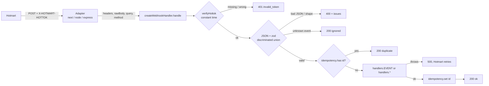

# @trichains/hotmart-webhooks

Typed, validated and testable Hotmart webhooks for Node.js: hottok verification, zod schemas for every v2.0.0 event, event routing with idempotency, framework adapters, fixtures and a CLI to fire fake events at your local endpoint.

[](https://github.com/trichains/hotmart-webhooks/actions/workflows/ci.yml)
[](LICENSE)


> Unofficial. This project is not affiliated with, endorsed by or maintained by Hotmart.

## Why

Hotmart is the main platform for selling digital products in Brazil: courses, memberships, ebooks. When something happens to a sale (approved, refunded, chargeback, subscription canceled) it calls your webhook URL. Every integration ends up writing the same code:

- compare the `X-HOTMART-HOTTOK` header with the account token (often with `===`, which leaks timing);
- `JSON.parse` the body and reach into `data.purchase.price.value` with no types;
- remember which events were already processed, because Hotmart retries;
- a big `switch (body.event)` to route events;
- hand-written JSON files to test it all locally.

This package does those parts once, with types derived from the official docs and tests around them.

## What it does

- **Schemas** for all 16 events documented for webhook v2.0.0 (zod v4), combined in a discriminated union on `event`. Unknown fields are kept and unknown enum values are accepted, so a Hotmart change does not take your endpoint down.
- **`verifyHottok`**: constant-time token check; header by default, legacy `?hottok=` query on opt-in.
- **`parseWebhook`**: token check + JSON + schema validation that returns `{ ok, event }` or `{ ok: false, error: { code, issues } }` instead of throwing.
- **`createWebhookHandler`**: route events to typed handlers (`PURCHASE_APPROVED`, ..., `"*"`), skip duplicates through a pluggable idempotency store, structured logs, sensible status codes.
- **Adapters** for Next.js App Router / any Fetch API runtime, `node:http` and Express. No framework is a dependency.
- **Helpers**: `isApprovedPurchase`, `normalizePurchase` (flat, storage-friendly row), `getBuyer`, `getTransactionId`, `toMinorUnits` (97.9 BRL to 9790 without float errors).
- **Fixtures** for every event under `@trichains/hotmart-webhooks/fixtures`, plus `createFixture` (deep overrides) and `createFixtureRequest` (a ready `Request` for route tests).
- **CLI**: `hotmart-webhooks send --event PURCHASE_APPROVED --url http://localhost:3000/api/hotmart` posts a fixture with the header, so you can test without a Hotmart sandbox.

## Install

```bash
npm install @trichains/hotmart-webhooks
```

`zod` comes along as a regular dependency. Node.js 18 or newer.

## 30-second example (Next.js App Router)

```ts
// app/api/hotmart/route.ts
import { createWebhookHandler, isApprovedPurchase, normalizePurchase } from "@trichains/hotmart-webhooks";
import { toNextRouteHandler } from "@trichains/hotmart-webhooks/adapters/next";

const handler = createWebhookHandler({
  token: process.env.HOTMART_HOTTOK!,
  handlers: {
    PURCHASE_APPROVED: async (event) => {
      // `event` is fully typed: event.data.purchase.transaction, event.data.buyer?.email, ...
      if (!isApprovedPurchase(event)) return;
      const sale = normalizePurchase(event);
      await grantAccess(sale.buyerEmail, sale.transaction);
    },
    PURCHASE_REFUNDED: (event) => revokeAccess(event.data.purchase.transaction),
    PURCHASE_CHARGEBACK: (event) => revokeAccess(event.data.purchase.transaction),
  },
});

export const runtime = "nodejs";
export const POST = toNextRouteHandler(handler);
```

Point the Hotmart webhook (version 2.0.0) at `https://your-site/api/hotmart` and put the hottok in `HOTMART_HOTTOK`. Full versions of this and of an Express server are in [`examples/`](examples) and are typechecked in CI against the built package.

## How a request flows



The core (`handle`) is a plain async function from `{ headers, rawBody, query, method }` to `{ status, body }`. Adapters only translate the framework's request and response objects, which is why they are a few lines each and why the core can be tested without a server.

| Status | When | Hotmart behaviour |
| --- | --- | --- |
| 200 | processed, duplicate, no handler, or unsupported event | done |
| 400 | body is not JSON or does not match the event schema | shown as failed in the webhook history |
| 401 | hottok missing or wrong | shown as failed |
| 405 | method other than POST | |
| 413 | body over 1 MiB (node/express adapters, configurable) | |
| 500 | your handler or the idempotency store threw | resent (up to five automatic attempts) |

```
src/
  events.ts          event names, categories, known enum values, EVENT_INFO
  schemas/           zod schemas: purchase.ts, other.ts, shared.ts, index.ts (union + types)
  verify.ts          verifyHottok / checkHottok / safeCompare
  parse.ts           parseWebhook, parseEvent (+ OrThrow variants)
  handler.ts         createWebhookHandler
  idempotency.ts     createMemoryIdempotencyStore
  helpers.ts         isApprovedPurchase, normalizePurchase, getBuyer, toDate, ...
  money.ts           toMinorUnits, fromMinorUnits, currencyDecimals
  adapters/          next.ts, node.ts, express.ts
  fixtures/          fake payloads, createFixture, createFixtureRequest
  cli/               argument parsing and the send / list-events commands
bin/hotmart-webhooks.ts   CLI entry
examples/                 Next.js route and Express server, typechecked against dist/
```

## API

Main entry: `@trichains/hotmart-webhooks`

| Export | What it does |
| --- | --- |
| `createWebhookHandler(options)` | Returns `{ handle(req) }`. Options: `token`, `handlers` (`{ [EVENT]?: fn, "*"?: fn }`), `idempotency?` (`{ has(id), set(id) }`, sync or async), `onError?(error, { event })`, `logger?` (console-like), `allowQueryToken?`. A specific handler wins over `"*"`. |
| `parseWebhook(rawBody, { token, headers, query?, allowQueryToken? })` | `{ ok: true, event }` or `{ ok: false, error: { code, message, issues?, event?, payload? } }`. Codes: `invalid_token`, `invalid_json`, `invalid_payload`, `unsupported_event`. Never throws for bad input. |
| `parseWebhookOrThrow(rawBody, options)` | Same, throws `HotmartWebhookError` (`code`, `issues`, `event`). |
| `parseEvent(payload)` / `parseEventOrThrow(payload)` | Validate an already-decoded object without a token check (queue workers, stored events). |
| `verifyHottok(input, { token, allowQueryToken? })` | `boolean`. `input` can be a `Request`, `Headers`, a Node header object or `{ headers, query }`. |
| `checkHottok(input, options)` | `{ valid: true, source: "header" \| "query" }` or `{ valid: false, reason: "missing" \| "mismatch" }`, for logging. |
| `safeCompare(a, b)` | SHA-256 + `crypto.timingSafeEqual`. |
| `createMemoryIdempotencyStore({ ttlMs?, maxEntries? })` | In-memory store with TTL and size cap. Dev, tests and single-process apps only. |
| `isApprovedPurchase(event)` | Type guard: event is PURCHASE_APPROVED/COMPLETE **and** `purchase.status` is APPROVED/COMPLETE. |
| `isPurchaseEvent(event)` | Type guard for the nine purchase events (shared payload). |
| `normalizePurchase(event)` | Flat object: `transaction, status, event, eventId, offerCode, productId, productName, buyerEmail, buyerName, priceValue, currency, fullPriceValue, paymentType, installments, approvedAt, orderedAt, isOrderBump, parentTransaction, subscriberCode, recurrenceNumber`. Missing values are `null`. |
| `getBuyer(event)` | `{ email?, name?, phone? }` from whatever the event calls the person (buyer, lead, subscriber, student, shopper). |
| `getTransactionId(event)` / `getSubscriberCode(event)` | The ids you usually key your records on. |
| `toDate(value)` | Hotmart timestamp (ms, s, numeric string or ISO) to `Date \| null`. |
| `toMinorUnits(value, currency)` / `toMinorUnits(money)` | Integer minor units with ISO 4217 decimals and half-away-from-zero rounding. `fromMinorUnits` and `currencyDecimals` too. |
| `webhookEventSchema`, `eventSchemas[EVENT]`, sub-schemas (`purchaseSchema`, `buyerSchema`, `productSchema`, ...) | The zod schemas, if you want to compose your own. |
| Types: `WebhookEvent`, `WebhookEventOf<"PURCHASE_APPROVED">`, `PurchaseEvent`, `PurchaseApprovedEvent`, ... | One type per event plus the union. |
| `WEBHOOK_EVENT_NAMES`, `eventCategories`, `EVENT_INFO`, `PURCHASE_STATUSES`, `PAYMENT_TYPES`, `SUBSCRIPTION_STATUSES` | Constants. |

Adapters:

| Import | Export | Signature |
| --- | --- | --- |
| `@trichains/hotmart-webhooks/adapters/next` | `toNextRouteHandler(handler)` (alias `toFetchHandler`) | `(request: Request) => Promise<Response>`. Made for Next.js route handlers (Node.js runtime). Any server that hands you a standard `Request` should work too (Hono, Remix/React Router actions, Bun); those are not tested here. |
| `@trichains/hotmart-webhooks/adapters/node` | `toNodeListener(handler, { maxBodyBytes? })` | `http.createServer(toNodeListener(handler))` |
| `@trichains/hotmart-webhooks/adapters/express` | `toExpressMiddleware(handler, { maxBodyBytes? })` | `app.post(path, toExpressMiddleware(handler))`. Uses `req.rawBody`, a Buffer/string `req.body`, a parsed JSON `req.body`, or reads the stream. |

Fixtures: `@trichains/hotmart-webhooks/fixtures` exports `fixtures`, `createFixture`, `createFixtureRequest`, `fixtureEventNames`, `deepMerge`, `setPath`.

## Events

From the v2.0.0 docs (links in [docs/REFERENCES.md](docs/REFERENCES.md)). "Paid" means the event represents money received; it is this library's reading of the docs, not a field Hotmart sends.

| Event | Category | Paid? | Meaning |
| --- | --- | --- | --- |
| `PURCHASE_APPROVED` | purchase | yes | Payment approved |
| `PURCHASE_COMPLETE` | purchase | yes | Purchase completed (warranty period over) |
| `PURCHASE_CANCELED` | purchase | no | Canceled or payment declined |
| `PURCHASE_REFUNDED` | purchase | no | Refunded |
| `PURCHASE_CHARGEBACK` | purchase | no | Chargeback |
| `PURCHASE_BILLET_PRINTED` | purchase | no | Boleto generated, waiting for payment |
| `PURCHASE_PROTEST` | purchase | no | Refund request / dispute opened |
| `PURCHASE_DELAYED` | purchase | no | Payment overdue (usually a subscription renewal) |
| `PURCHASE_EXPIRED` | purchase | no | Unpaid order expired |
| `PURCHASE_OUT_OF_SHOPPING_CART` | abandonment | no | Checkout abandoned; lead data only |
| `SUBSCRIPTION_CANCELLATION` | subscription | no | Subscription canceled (access usually runs until `date_next_charge`) |
| `SWITCH_PLAN` | subscription | no | Subscriber changed plans |
| `UPDATE_SUBSCRIPTION_CHARGE_DATE` | subscription | no | Subscriber changed the billing day |
| `CLUB_FIRST_ACCESS` | club | no | First access to the members area |
| `CLUB_MODULE_COMPLETED` | club | no | Student completed a module |
| `ORDER_FULFILLMENT` | logistics | no | Logistics data for an approved physical order |

The nine purchase events share one payload (`data.product`, `data.buyer`, `data.purchase`, `data.subscription`, ...). Events not in this table get `200 { ignored: "unsupported_event" }` from the handler, so Hotmart does not keep retrying them; `parseWebhook` exposes the raw payload in `error.payload`. Run `npx hotmart-webhooks list-events` for the same table in your terminal.

## Idempotency

According to Hotmart's help center, deliveries that fail are resent automatically up to five times (until your server answers with success), and anyone with dashboard access can resend an event manually from the webhook history. So the same event can arrive more than once. Every event has a unique `id`; the handler uses it as the idempotency key:

1. `has(id)` true: reply `200 { duplicate: true }` without running your handler.
2. Otherwise run the handler, and only after it succeeds call `set(id)`. A failed handler leaves the id unmarked, so the retry runs it again.

```ts
import { createWebhookHandler } from "@trichains/hotmart-webhooks";

const handler = createWebhookHandler({
  token: process.env.HOTMART_HOTTOK!,
  handlers,
  idempotency: {
    has: async (id) => (await redis.exists(`hotmart:${id}`)) === 1,
    set: async (id) => void (await redis.set(`hotmart:${id}`, "1", "EX", 60 * 60 * 24 * 30)),
  },
});
```

Things to know:

- `has` then `set` is not atomic. Two concurrent deliveries of the same id can both run. If that matters (sending e-mails, granting credits), make the side effect itself idempotent: a unique index on `transaction` + event, an upsert, or `SET NX` as a lock inside your handler.
- The event id identifies a delivery of one event. A purchase goes through several events (BILLET_PRINTED, APPROVED, later REFUNDED), each with its own id. Key your business records on `purchase.transaction`.
- `createMemoryIdempotencyStore()` forgets everything on restart and is not shared across instances or serverless invocations. Use it for development and tests.

## Testing with fixtures

```ts
import { describe, expect, it } from "vitest";
import { createFixture, createFixtureRequest } from "@trichains/hotmart-webhooks/fixtures";
import { POST } from "@/app/api/hotmart/route";

describe("hotmart webhook route", () => {
  it("grants access on an approved purchase", async () => {
    const res = await POST(createFixtureRequest("PURCHASE_APPROVED", { token: process.env.HOTMART_HOTTOK! }));
    expect(res.status).toBe(200);
  });

  it("rejects a forged request", async () => {
    const res = await POST(createFixtureRequest("PURCHASE_APPROVED", { token: "wrong" }));
    expect(res.status).toBe(401);
  });

  it("handles a high-ticket order bump", () => {
    const event = createFixture("PURCHASE_APPROVED", {
      data: { purchase: { price: { value: 1997 }, order_bump: { is_order_bump: true } } },
    });
    // call your domain code with `event` directly
  });
});
```

All fixture data is fake (`@example.com` addresses, `HP00000000xx` transactions, all-zero documents). The `purchase.status` paired with each purchase event is a plausible choice; the docs do not specify it per event.

## CLI

```bash
# Send a fixture with the hottok header (token from the environment, so it stays out of shell history)
HOTMART_HOTTOK=dev-token npx hotmart-webhooks send \
  --event PURCHASE_APPROVED \
  --url http://localhost:3000/api/hotmart \
  --override data.purchase.price.value=197

# Print the payload instead of sending it
npx hotmart-webhooks send -e PURCHASE_REFUNDED --dry-run

# See every supported event
npx hotmart-webhooks list-events
```

Output of a real run against the Node adapter:

```
-> POST http://127.0.0.1:3104/api/hotmart
   event PURCHASE_APPROVED
   id    evt-demo-1
   tx    HP0000000001
<- 200 OK (171 ms)
{"ok":true,"id":"evt-demo-1","event":"PURCHASE_APPROVED"}
```

Options: `--token` (or `$HOTMART_HOTTOK`), repeatable `--override path=value` (values are parsed as JSON when possible: `97`, `true`, `"007"`), `--id` (default: a new UUID per run, so repeated sends are not treated as duplicates; pass the same `--id` twice to test idempotency), `--legacy-query`, `--dry-run`, `--timeout`. Exit code is 0 for 2xx, 1 otherwise, 2 for usage errors. The only runtime dependency is zod; it uses Node's built-in `fetch` and `util.parseArgs`.

## Security notes

- **Constant-time comparison.** `a === b` returns as soon as a character differs, so response times can leak how much of a guessed token is right. `safeCompare` hashes both values with SHA-256 and compares them with `crypto.timingSafeEqual`, which also hides the token length.
- **The hottok is the only authentication.** Hotmart does not sign the body. Anyone with the token can forge events, so keep it in an environment variable, rotate it through Hotmart support if it leaks, and never log it (the handler's logs never include it). The query-string fallback is off by default because URLs end up in access logs.
- **Do not trust `purchase.status` alone, and do not trust the event name alone.** `isApprovedPurchase` requires both to agree; the official example itself pairs `PURCHASE_APPROVED` with status `STARTED`. Events can also arrive out of order (a retried APPROVED after a REFUNDED), so keep per-transaction state and compare `creation_date` before granting access. For high-value actions, confirm with Hotmart's sales API.
- **Reply 2xx fast and do the heavy work elsewhere.** Hotmart treats slow responses as failures (408) and resends them, and its help center says a URL that keeps failing can get the webhook configuration deactivated. Validate and enqueue in the handler (a queue, a database row, `waitUntil` on your platform), then send e-mails, call CRMs and grant access in a worker. `parseEvent` revalidates stored payloads in that worker.
- **Body size.** The Node and Express adapters stop reading at 1 MiB (`maxBodyBytes`) and answer 413.
- **Runtime.** Token comparison uses `node:crypto`, so the Next.js adapter needs the Node.js runtime (`export const runtime = "nodejs"`), not Edge.

## Key decisions and trade-offs

- **Loose schemas over strict ones.** Objects are `z.looseObject` and enum-like strings accept any value while keeping autocomplete for the documented ones. Hotmart's own docs disagree with their examples in several places (listed in [docs/REFERENCES.md](docs/REFERENCES.md)); rejecting a real payment because of a new enum value would be worse than accepting a field you did not expect.
- **Results instead of exceptions.** `parseWebhook` returns a discriminated result so every failure mode is visible in the type and maps directly to a status code. `*OrThrow` variants exist for code that prefers exceptions.
- **Unsupported events get 200, invalid payloads get 400.** Answering 4xx to an event name this version does not know would only produce failed deliveries; it is acknowledged and logged as `hotmart.webhook.ignored`. A known event that fails validation is different: it may be a forged or broken request, so it gets a 400 and stays visible (and resendable) in Hotmart's webhook history. The catch is that if Hotmart changes a payload in a way the schema rejects, those deliveries fail until the package is updated; watch for `hotmart.webhook.rejected` with `reason: "invalid_payload"` in your logs.
- **Mark idempotent after success.** A crash mid-handler means the retry runs again instead of being silently swallowed. The cost is that handlers must tolerate re-execution, which they need anyway because of the has/set race.
- **One subpath per adapter.** `adapters/next`, `adapters/node` and `adapters/express` are separate entry points so importing one does not drag in the others, and the main entry stays framework-free. They use small structural types instead of importing framework types, so there are no peer dependencies.
- **Dual ESM/CJS build with tsup**, `sideEffects: false`, `typesVersions` for TypeScript projects still on `moduleResolution: node`. `publint` and `@arethetypeswrong/cli` run in CI.
- **Money as integers.** `toMinorUnits` shifts the decimal point through the number's string form (`"97.9e2"`) rather than multiplying, so `1.005` BRL becomes 101 cents, not 100.

## Stack

TypeScript 6 (strict), zod 4, tsup, Vitest 5 with V8 coverage, ESLint 10 + typescript-eslint, Changesets, publint, @arethetypeswrong/cli, GitHub Actions. Express is a dev dependency only, for the adapter tests and the example.

## Development

```bash
git clone https://github.com/trichains/hotmart-webhooks
cd hotmart-webhooks
npm install

npm run lint
npm run typecheck
npm test                    # or npm run test:coverage
npm run build
npm run typecheck:examples  # needs the build
npm run check:package       # publint + attw on the packed tarball
npm run smoke               # loads dist/ as ESM and CJS
```

To try the CLI against your own app, copy `.env.example` to `.env`, set any `HOTMART_HOTTOK` your server also uses, then `node dist/cli.js send -e PURCHASE_APPROVED -u http://localhost:3000/api/hotmart`.

Releases: add a changeset with `npx changeset`, run `npx changeset version`, commit, then push a `vX.Y.Z` tag. The release workflow only runs on tags, checks that the tag matches `package.json`, and refuses to publish without an `NPM_TOKEN` secret.

## Limitations

- Unofficial. Schemas follow the public docs as of October 2026 and can lag behind Hotmart changes. Loose parsing reduces the impact, but new required fields will not be typed until the package is updated.
- Only webhook version 2.0.0 is modelled. v1.0.0 (form-encoded, different field names) is not parsed; only its `?hottok=` query is supported for token checks.
- The payloads were modelled from documentation, not captured from production traffic. If you see a real payload that fails validation, please open an issue with the (redacted) `issues` output.
- `ORDER_FULFILLMENT` is typed only for the commonly used fields; the rest passes through.
- No Edge runtime support (uses `node:crypto`).
- The memory idempotency store is per-process.
- Not published to npm yet.

## Roadmap

- Redis and Postgres idempotency store recipes (or small optional packages).
- Edge-compatible token comparison via Web Crypto, so the Fetch adapter can run on Edge runtimes.
- A `waitUntil` option to acknowledge first and process after the response on platforms that support it.
- Typed client for the Hotmart sales API, to confirm purchases before granting high-value access.
- Contract tests from real, redacted payloads contributed by users.

## License

[MIT](LICENSE) © 2026 Cristhian Almeida. Hotmart is a trademark of its owner; this project is not affiliated with Hotmart.
