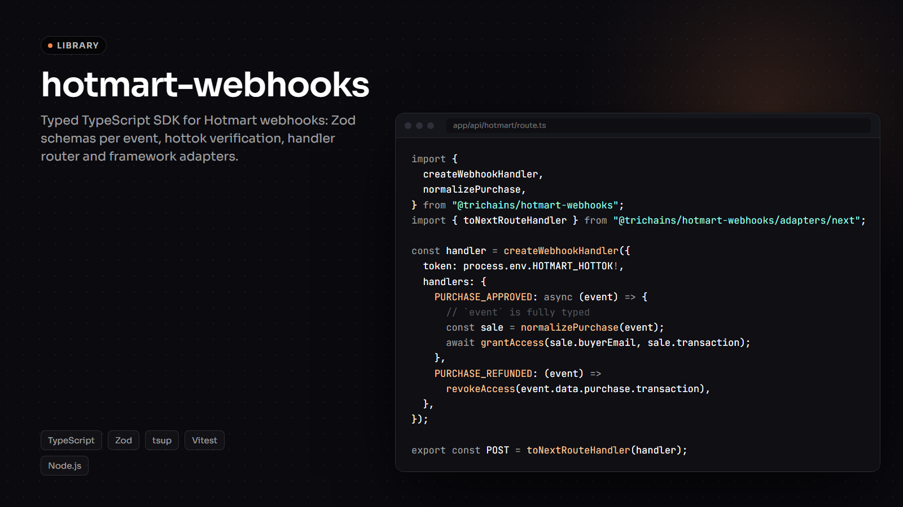
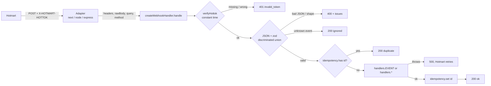

# @trichains/hotmart-webhooks

[English](README.md) · [Português](README.pt-BR.md)

Webhooks da Hotmart tipados, validados e testáveis para Node.js: verificação do hottok, schemas zod para todos os eventos da v2.0.0, roteamento de eventos com idempotência, adapters para frameworks, fixtures e uma CLI para disparar eventos falsos no seu endpoint local.

[](https://github.com/trichains/hotmart-webhooks/actions/workflows/ci.yml)
[](LICENSE)




> Não oficial. Este projeto não tem vínculo com a Hotmart, nem é endossado ou mantido por ela.

## Por quê

A Hotmart é a principal plataforma de venda de produtos digitais no Brasil: cursos, assinaturas, ebooks. Quando algo acontece com uma venda (aprovada, reembolsada, chargeback, assinatura cancelada), ela chama a URL do seu webhook. Toda integração acaba escrevendo o mesmo código:

- comparar o header `X-HOTMART-HOTTOK` com o token da conta (muitas vezes com `===`, que vaza informação pelo tempo de resposta);
- dar `JSON.parse` no body e ir buscar `data.purchase.price.value` sem tipo nenhum;
- lembrar quais eventos já foram processados, porque a Hotmart reenvia;
- um `switch (body.event)` enorme para rotear os eventos;
- arquivos JSON escritos à mão para testar tudo localmente.

Este pacote resolve essas partes uma vez só, com tipos derivados da documentação oficial e testes em volta.

## O que ele faz

- **Schemas** para os 16 eventos documentados no webhook v2.0.0 (zod v4), reunidos numa discriminated union pelo campo `event`. Campos desconhecidos são mantidos e valores de enum desconhecidos são aceitos, então uma mudança da Hotmart não derruba o seu endpoint.
- **`verifyHottok`**: checagem do token em tempo constante; pelo header por padrão, e pela query legada `?hottok=` só se você ativar.
- **`parseWebhook`**: checagem do token + JSON + validação do schema, que devolve `{ ok, event }` ou `{ ok: false, error: { code, issues } }` em vez de lançar exceção.
- **`createWebhookHandler`**: roteia eventos para handlers tipados (`PURCHASE_APPROVED`, ..., `"*"`), ignora duplicados por meio de um store de idempotência plugável, gera logs estruturados e usa status codes coerentes.
- **Adapters** para o App Router do Next.js / qualquer runtime com Fetch API, `node:http` e Express. Nenhum framework é dependência.
- **Helpers**: `isApprovedPurchase`, `normalizePurchase` (linha plana, fácil de salvar no banco), `getBuyer`, `getTransactionId`, `toMinorUnits` (97,9 BRL vira 9790 sem erro de ponto flutuante).
- **Fixtures** para todos os eventos em `@trichains/hotmart-webhooks/fixtures`, além de `createFixture` (overrides profundos) e `createFixtureRequest` (um `Request` pronto para testar rotas).
- **CLI**: `hotmart-webhooks send --event PURCHASE_APPROVED --url http://localhost:3000/api/hotmart` envia uma fixture com o header, para você testar sem sandbox da Hotmart.

## Instalação

```bash
npm install @trichains/hotmart-webhooks
```

O `zod` vem junto como dependência normal. Node.js 18 ou mais recente.

## Exemplo em 30 segundos (Next.js App Router)

```ts
// app/api/hotmart/route.ts
import { createWebhookHandler, isApprovedPurchase, normalizePurchase } from "@trichains/hotmart-webhooks";
import { toNextRouteHandler } from "@trichains/hotmart-webhooks/adapters/next";

const handler = createWebhookHandler({
  token: process.env.HOTMART_HOTTOK!,
  handlers: {
    PURCHASE_APPROVED: async (event) => {
      // `event` is fully typed: event.data.purchase.transaction, event.data.buyer?.email, ...
      if (!isApprovedPurchase(event)) return;
      const sale = normalizePurchase(event);
      await grantAccess(sale.buyerEmail, sale.transaction);
    },
    PURCHASE_REFUNDED: (event) => revokeAccess(event.data.purchase.transaction),
    PURCHASE_CHARGEBACK: (event) => revokeAccess(event.data.purchase.transaction),
  },
});

export const runtime = "nodejs";
export const POST = toNextRouteHandler(handler);
```

Aponte o webhook da Hotmart (versão 2.0.0) para `https://seu-site/api/hotmart` e coloque o hottok em `HOTMART_HOTTOK`. As versões completas deste exemplo e de um servidor Express estão em [`examples/`](examples) e passam por typecheck no CI contra o pacote buildado.

## Como uma requisição flui



O núcleo (`handle`) é uma função async simples que recebe `{ headers, rawBody, query, method }` e devolve `{ status, body }`. Os adapters só traduzem os objetos de request e response do framework; por isso cada um tem poucas linhas e o núcleo pode ser testado sem subir servidor.

| Status | Quando | Comportamento da Hotmart |
| --- | --- | --- |
| 200 | processado, duplicado, sem handler ou evento não suportado | concluído |
| 400 | o body não é JSON ou não bate com o schema do evento | aparece como falha no histórico do webhook |
| 401 | hottok ausente ou errado | aparece como falha |
| 405 | método diferente de POST | |
| 413 | body acima de 1 MiB (todos os adapters, ajustável com `maxBodyBytes`) | |
| 500 | seu handler ou o store de idempotência lançou erro | reenviado (até cinco tentativas automáticas) |

```
src/
  events.ts          event names, categories, known enum values, EVENT_INFO
  schemas/           zod schemas: purchase.ts, other.ts, shared.ts, index.ts (union + types)
  verify.ts          verifyHottok / checkHottok / safeCompare
  parse.ts           parseWebhook, parseEvent (+ OrThrow variants)
  handler.ts         createWebhookHandler
  idempotency.ts     createMemoryIdempotencyStore
  helpers.ts         isApprovedPurchase, normalizePurchase, getBuyer, toDate, ...
  money.ts           toMinorUnits, fromMinorUnits, currencyDecimals
  adapters/          next.ts, node.ts, express.ts
  fixtures/          fake payloads, createFixture, createFixtureRequest
  cli/               argument parsing and the send / list-events commands
bin/hotmart-webhooks.ts   CLI entry
examples/                 Next.js route and Express server, typechecked against dist/
```

## API

Entry principal: `@trichains/hotmart-webhooks`

| Export | O que faz |
| --- | --- |
| `createWebhookHandler(options)` | Devolve `{ handle(req) }`. Opções: `token`, `handlers` (`{ [EVENT]?: fn, "*"?: fn }`), `idempotency?` (`{ has(id), set(id) }`, síncrono ou assíncrono), `onError?(error, { event })`, `onInvalidPayload?(error)` (requisição autenticada que não é JSON ou falha na validação: salve o `error.payload` para não perder nada), `logger?` (no estilo do `console`; um logger que lança erro é ignorado), `allowQueryToken?`. Um handler específico tem prioridade sobre o `"*"`. `handle()` nunca rejeita. |
| `parseWebhook(rawBody, { token, headers, query?, allowQueryToken? })` | `{ ok: true, event }` ou `{ ok: false, error: { code, message, issues?, event?, payload? } }`. Códigos: `invalid_token`, `invalid_json`, `invalid_payload`, `unsupported_event`. Nunca lança exceção por entrada inválida. |
| `parseWebhookOrThrow(rawBody, options)` | Igual, mas lança `HotmartWebhookError` (`code`, `issues`, `event`). Use `HotmartWebhookError.is(err)` em vez de `instanceof` se os builds ESM e CJS puderem acabar carregados juntos. |
| `parseEvent(payload)` / `parseEventOrThrow(payload)` | Valida um objeto já decodificado, sem checar o token (workers de fila, eventos armazenados). |
| `stripNulls(value)` | Cópia sem as propriedades `null`. As funções de parse aplicam isso antes, então um campo opcional `null` conta como ausente; um campo obrigatório `null` continua falhando. Os schemas zod puros não fazem isso sozinhos. |
| `verifyHottok(input, { token, allowQueryToken? })` | `boolean`. `input` pode ser um `Request`, um `Headers`, um objeto de headers do Node ou `{ headers, query }`. |
| `checkHottok(input, options)` | `{ valid: true, source: "header" \| "query" }` ou `{ valid: false, reason: "missing" \| "mismatch" }`, para log. |
| `safeCompare(a, b)` | SHA-256 + `crypto.timingSafeEqual`. |
| `createMemoryIdempotencyStore({ ttlMs?, maxEntries? })` | Store em memória com TTL e limite de tamanho. Só para desenvolvimento, testes e apps de processo único. |
| `isApprovedPurchase(event)` | Type guard: o evento é PURCHASE_APPROVED/COMPLETE **e** o `purchase.status` é APPROVED/COMPLETE. |
| `isPurchaseEvent(event)` | Type guard para os nove eventos de compra (payload compartilhado). |
| `normalizePurchase(event)` | Objeto plano: `transaction, status, event, eventId, offerCode, productId, productName, buyerEmail, buyerName, priceValue, currency, fullPriceValue, paymentType, installments, approvedAt, orderedAt, isOrderBump, parentTransaction, subscriberCode, recurrenceNumber`. Valores ausentes viram `null`. |
| `getBuyer(event)` | `{ email?, name?, phone? }` a partir de como quer que o evento chame a pessoa (buyer, lead, subscriber, aluno, shopper). |
| `getTransactionId(event)` / `getSubscriberCode(event)` | Os ids que você normalmente usa como chave dos seus registros. |
| `toDate(value)` | Timestamp da Hotmart (ms, s, string numérica ou ISO 8601) para `Date \| null`. Datas-hora ISO sem offset são lidas como UTC; qualquer outra coisa devolve `null`. |
| `toMinorUnits(value, currency)` / `toMinorUnits(money)` | Valor inteiro na menor unidade da moeda, com as casas decimais da ISO 4217 e arredondamento "metade para longe do zero". Também há `fromMinorUnits` e `currencyDecimals`. |
| `webhookEventSchema`, `eventSchemas[EVENT]`, sub-schemas (`purchaseSchema`, `buyerSchema`, `productSchema`, ...) | Os schemas zod, caso você queira compor os seus. |
| Tipos: `WebhookEvent`, `WebhookEventOf<"PURCHASE_APPROVED">`, `PurchaseEvent`, `PurchaseApprovedEvent`, ... | Um tipo por evento, mais a union. |
| `WEBHOOK_EVENT_NAMES`, `eventCategories`, `EVENT_INFO`, `PURCHASE_STATUSES`, `PAYMENT_TYPES`, `SUBSCRIPTION_STATUSES` | Constantes. |

Adapters:

| Import | Export | Assinatura |
| --- | --- | --- |
| `@trichains/hotmart-webhooks/adapters/next` | `toNextRouteHandler(handler, { maxBodyBytes? })` (alias `toFetchHandler`) | `(request: Request) => Promise<Response>`. Feito para route handlers do Next.js (runtime Node.js). Qualquer servidor que entregue um `Request` padrão deve funcionar também (Hono, actions do Remix/React Router, Bun); esses casos não são testados aqui. |
| `@trichains/hotmart-webhooks/adapters/node` | `toNodeListener(handler, { maxBodyBytes? })` | `http.createServer(toNodeListener(handler))` |
| `@trichains/hotmart-webhooks/adapters/express` | `toExpressMiddleware(handler, { maxBodyBytes? })` | `app.post(path, toExpressMiddleware(handler))`. Usa `req.rawBody`, um `req.body` Buffer/string, um `req.body` com JSON já parseado, ou lê o stream. |

Fixtures: `@trichains/hotmart-webhooks/fixtures` exporta `fixtures`, `createFixture`, `createFixtureRequest`, `fixtureEventNames`, `deepMerge`, `setPath`.

## Eventos

Conforme a documentação da v2.0.0 (links em [docs/REFERENCES.md](docs/REFERENCES.md)). "Pago" significa que o evento representa dinheiro recebido; é a leitura desta biblioteca sobre a documentação, não um campo enviado pela Hotmart.

| Evento | Categoria | Pago? | Significado |
| --- | --- | --- | --- |
| `PURCHASE_APPROVED` | purchase | sim | Pagamento aprovado |
| `PURCHASE_COMPLETE` | purchase | sim | Compra completa (fim do prazo de garantia) |
| `PURCHASE_CANCELED` | purchase | não | Cancelada ou pagamento recusado |
| `PURCHASE_REFUNDED` | purchase | não | Reembolsada |
| `PURCHASE_CHARGEBACK` | purchase | não | Chargeback |
| `PURCHASE_BILLET_PRINTED` | purchase | não | Boleto gerado, aguardando pagamento |
| `PURCHASE_PROTEST` | purchase | não | Pedido de reembolso / disputa aberta |
| `PURCHASE_DELAYED` | purchase | não | Pagamento atrasado (normalmente renovação de assinatura) |
| `PURCHASE_EXPIRED` | purchase | não | Pedido não pago expirou |
| `PURCHASE_OUT_OF_SHOPPING_CART` | abandonment | não | Abandono de checkout; só dados do lead |
| `SUBSCRIPTION_CANCELLATION` | subscription | não | Assinatura cancelada (o acesso costuma ir até `date_next_charge`) |
| `SWITCH_PLAN` | subscription | não | Assinante trocou de plano |
| `UPDATE_SUBSCRIPTION_CHARGE_DATE` | subscription | não | Assinante mudou o dia de cobrança |
| `CLUB_FIRST_ACCESS` | club | não | Primeiro acesso à área de membros |
| `CLUB_MODULE_COMPLETED` | club | não | Aluno concluiu um módulo |
| `ORDER_FULFILLMENT` | logistics | não | Dados logísticos de um pedido físico aprovado |

Os nove eventos de compra compartilham o mesmo payload (`data.product`, `data.buyer`, `data.purchase`, `data.subscription`, ...). Eventos fora desta tabela recebem `200 { ignored: "unsupported_event" }` do handler, para a Hotmart não ficar reenviando; o `parseWebhook` expõe o payload bruto em `error.payload`. Rode `npx hotmart-webhooks list-events` para ver a mesma tabela no terminal.

## Idempotência

Segundo a central de ajuda da Hotmart, envios que falham são reenviados automaticamente até cinco vezes (até o seu servidor responder com sucesso), e qualquer pessoa com acesso ao painel pode reenviar um evento manualmente pelo histórico do webhook. Ou seja, o mesmo evento pode chegar mais de uma vez. Todo evento tem um `id` único, que o handler usa como chave de idempotência:

1. `has(id)` verdadeiro: responde `200 { duplicate: true }` sem rodar o seu handler.
2. Caso contrário, roda o handler e só chama `set(id)` depois que ele termina com sucesso. Um handler que falha deixa o id sem marcação, então o reenvio roda de novo.
3. Se o próprio `set(id)` falhar depois de o handler dar certo, a resposta continua sendo 200 (o trabalho já foi feito; um 500 faria a Hotmart reenviar e repetir os efeitos colaterais). A falha vai para o log como `hotmart.webhook.idempotency_set_failed`.

```ts
import { createWebhookHandler } from "@trichains/hotmart-webhooks";

const handler = createWebhookHandler({
  token: process.env.HOTMART_HOTTOK!,
  handlers,
  idempotency: {
    has: async (id) => (await redis.exists(`hotmart:${id}`)) === 1,
    set: async (id) => void (await redis.set(`hotmart:${id}`, "1", "EX", 60 * 60 * 24 * 30)),
  },
});
```

Vale saber:

- `has` seguido de `set` não é atômico. Duas entregas simultâneas do mesmo id podem rodar as duas. Se isso importa (envio de e-mail, liberação de créditos), torne o próprio efeito colateral idempotente: um índice único em `transaction` + evento, um upsert, ou `SET NX` como lock dentro do handler.
- O id do evento identifica uma entrega de um evento. Uma compra passa por vários eventos (BILLET_PRINTED, APPROVED, depois REFUNDED), cada um com seu id. Use `purchase.transaction` como chave dos seus registros de negócio.
- `createMemoryIdempotencyStore()` esquece tudo quando o processo reinicia e não é compartilhado entre instâncias nem entre invocações serverless. Use em desenvolvimento e testes.

## Testes com fixtures

```ts
import { describe, expect, it } from "vitest";
import { createFixture, createFixtureRequest } from "@trichains/hotmart-webhooks/fixtures";
import { POST } from "@/app/api/hotmart/route";

describe("hotmart webhook route", () => {
  it("grants access on an approved purchase", async () => {
    const res = await POST(createFixtureRequest("PURCHASE_APPROVED", { token: process.env.HOTMART_HOTTOK! }));
    expect(res.status).toBe(200);
  });

  it("rejects a forged request", async () => {
    const res = await POST(createFixtureRequest("PURCHASE_APPROVED", { token: "wrong" }));
    expect(res.status).toBe(401);
  });

  it("handles a high-ticket order bump", () => {
    const event = createFixture("PURCHASE_APPROVED", {
      data: { purchase: { price: { value: 1997 }, order_bump: { is_order_bump: true } } },
    });
    // call your domain code with `event` directly
  });
});
```

Todos os dados das fixtures são falsos (endereços `@example.com`, transações `HP00000000xx`, documentos zerados). O `purchase.status` associado a cada evento de compra é uma escolha plausível; a documentação não especifica isso por evento. O objeto `fixtures` exportado é congelado em profundidade; `createFixture` devolve uma cópia mutável. Cada fixture tem um `id` fixo, então, se o seu handler usa um store de idempotência, passe `{ id: "..." }` nos overrides para simular entregas diferentes.

## CLI

```bash
# Send a fixture with the hottok header (token from the environment, so it stays out of shell history)
HOTMART_HOTTOK=dev-token npx hotmart-webhooks send \
  --event PURCHASE_APPROVED \
  --url http://localhost:3000/api/hotmart \
  --override data.purchase.price.value=197

# Print the payload instead of sending it
npx hotmart-webhooks send -e PURCHASE_REFUNDED --dry-run

# See every supported event
npx hotmart-webhooks list-events
```

Saída de uma execução real contra o adapter do Node:

```
-> POST http://127.0.0.1:3104/api/hotmart
   event PURCHASE_APPROVED
   id    evt-demo-1
   tx    HP0000000001
<- 200 OK (171 ms)
{"ok":true,"id":"evt-demo-1","event":"PURCHASE_APPROVED"}
```

Opções: `--token` (ou `$HOTMART_HOTTOK`), `--override path=value` repetível (os valores são interpretados como JSON quando possível: `97`, `true`, `"007"`), `--id` (padrão: um UUID novo a cada execução, para que envios repetidos não sejam tratados como duplicados; passe o mesmo `--id` duas vezes para testar a idempotência), `--legacy-query`, `--dry-run`, `--timeout`. O exit code é 0 para 2xx, 1 nos demais casos e 2 para erro de uso. A única dependência de runtime é o zod; a CLI usa o `fetch` e o `util.parseArgs` nativos do Node.

## Notas de segurança

- **Comparação em tempo constante.** `a === b` retorna assim que um caractere difere, então o tempo de resposta pode revelar quanto de um token chutado está certo. O `safeCompare` gera o hash SHA-256 dos dois valores e compara com `crypto.timingSafeEqual`, o que também esconde o tamanho do token.
- **O hottok é a única autenticação.** A Hotmart não assina o body. Quem tiver o token consegue forjar eventos, então guarde-o numa variável de ambiente, peça a troca ao suporte da Hotmart se ele vazar e nunca o coloque em log (os logs do handler nunca incluem o token). O fallback por query string vem desligado porque URLs acabam em logs de acesso. Espaços em volta do token configurado (uma quebra de linha no fim vinda de um arquivo env, por exemplo) são removidos, já que um hottok nunca tem espaços.
- **Não confie só no `purchase.status`, nem só no nome do evento.** O `isApprovedPurchase` exige que os dois concordem; o próprio exemplo oficial combina `PURCHASE_APPROVED` com status `STARTED`. Os eventos também podem chegar fora de ordem (um APPROVED reenviado depois de um REFUNDED), então mantenha estado por transação e compare o `creation_date` antes de liberar acesso. Para ações de alto valor, confirme na API de vendas da Hotmart.
- **Responda 2xx rápido e faça o trabalho pesado em outro lugar.** A Hotmart trata respostas lentas como falha (408) e reenvia, e a central de ajuda diz que uma URL que falha repetidamente pode ter a configuração do webhook desativada. Valide e enfileire no handler (uma fila, uma linha no banco, `waitUntil` na sua plataforma) e depois envie e-mails, chame CRMs e libere acesso num worker. O `parseEvent` revalida os payloads armazenados nesse worker.
- **Tamanho do body.** Todos os adapters param de ler em 1 MiB (`maxBodyBytes`) e respondem 413.
- **Runtime.** A comparação do token usa `node:crypto`, então o adapter do Next.js precisa do runtime Node.js (`export const runtime = "nodejs"`), não do Edge.

## Decisões e trade-offs

- **Schemas permissivos em vez de estritos.** Os objetos são `z.looseObject` e as strings do tipo enum aceitam qualquer valor, mantendo o autocomplete para os documentados. A própria documentação da Hotmart contradiz seus exemplos em vários pontos (listados em [docs/REFERENCES.md](docs/REFERENCES.md)); rejeitar um pagamento real por causa de um valor de enum novo seria pior do que aceitar um campo inesperado. `null` é tratado como "ausente" pelo mesmo motivo. O custo do lado dos tipos: objetos permissivos carregam uma index signature, então um erro de digitação como `event.data.purchase.aproved_date` compila (como `unknown`) em vez de falhar. Os campos conhecidos são totalmente tipados e o narrowing por `event.event` funciona.
- **zod como dependência normal.** O zod vai como dependência, e não como peer, para que um único `npm install` baste. Se o seu app usa outra versão major do zod, os schemas exportados não são intercambiáveis com as suas instâncias de zod; as funções de parse e os tipos não são afetados.
- **Resultados em vez de exceções.** O `parseWebhook` devolve um resultado discriminado, então todo modo de falha aparece no tipo e mapeia direto para um status code. As variantes `*OrThrow` existem para quem prefere exceções.
- **Eventos não suportados recebem 200, payloads inválidos recebem 400.** Responder 4xx para um nome de evento que esta versão não conhece só geraria entregas com falha; ele é confirmado e registrado no log como `hotmart.webhook.ignored`. Um evento conhecido que falha na validação é outra história: pode ser uma requisição forjada ou quebrada, então recebe 400 e continua visível (e reenviável) no histórico de webhooks da Hotmart. O porém é que, se a Hotmart mudar um payload de um jeito que o schema rejeite, essas entregas vão falhar até o pacote ser atualizado; fique de olho em `hotmart.webhook.rejected` com `reason: "invalid_payload"` nos logs e use o `onInvalidPayload` para guardar o payload bruto e reprocessá-lo depois.
- **Marcar como processado só depois do sucesso.** Se o handler quebrar no meio, o reenvio roda de novo em vez de o evento ser engolido em silêncio. O custo é que os handlers precisam tolerar reexecução, o que já seria necessário por causa da corrida entre has e set.
- **Um subpath por adapter.** `adapters/next`, `adapters/node` e `adapters/express` são entry points separados, para que importar um não traga os outros e o entry principal fique livre de framework. Eles usam tipos estruturais pequenos em vez de importar tipos dos frameworks, então não há peer dependencies.
- **Build dual ESM/CJS com tsup**, `sideEffects: false`, `typesVersions` para projetos TypeScript que ainda usam `moduleResolution: node`. `publint` e `@arethetypeswrong/cli` rodam no CI.
- **Dinheiro como inteiro.** O `toMinorUnits` desloca a vírgula pela forma em string do número (`"97.9e2"`) em vez de multiplicar, então `1.005` BRL vira 101 centavos, e não 100.

## Stack

TypeScript 6 (strict), zod 4, tsup, Vitest 5 com coverage V8, ESLint 10 + typescript-eslint, Changesets, publint, @arethetypeswrong/cli, GitHub Actions. O Express é só dependência de desenvolvimento, usada nos testes dos adapters e no exemplo.

## Desenvolvimento

```bash
git clone https://github.com/trichains/hotmart-webhooks
cd hotmart-webhooks
npm install

npm run lint
npm run typecheck
npm test                    # or npm run test:coverage
npm run build
npm run typecheck:examples  # needs the build
npm run check:package       # publint + attw on the packed tarball
npm run smoke               # loads dist/ as ESM and CJS
```

Para testar a CLI contra o seu próprio app, copie `.env.example` para `.env`, defina um `HOTMART_HOTTOK` qualquer que o seu servidor também use e rode `node dist/cli.js send -e PURCHASE_APPROVED -u http://localhost:3000/api/hotmart`.

Releases: adicione um changeset com `npx changeset`, rode `npx changeset version`, faça o commit e dê push numa tag `vX.Y.Z`. O workflow de release só roda em tags, confere se a tag bate com o `package.json` e se recusa a publicar sem o secret `NPM_TOKEN`.

## Limitações

- Não oficial. Os schemas seguem a documentação pública de outubro de 2026 e podem ficar atrás das mudanças da Hotmart. O parse permissivo reduz o impacto, mas campos obrigatórios novos só serão tipados quando o pacote for atualizado.
- Só a versão 2.0.0 do webhook é modelada. A v1.0.0 (form-encoded, nomes de campo diferentes) não é parseada; dela, só a query `?hottok=` é suportada na checagem do token.
- Os payloads foram modelados a partir da documentação, não capturados de tráfego de produção. Se você receber um payload real que falhe na validação, abra uma issue com a saída de `issues` (sem dados sensíveis).
- `ORDER_FULFILLMENT` só tem tipos para os campos mais usados; o resto passa direto.
- Sem suporte ao runtime Edge (usa `node:crypto`).
- O store de idempotência em memória é por processo.
- Ainda não publicado no npm.

## Roadmap

- Receitas de store de idempotência com Redis e Postgres (ou pequenos pacotes opcionais).
- Comparação de token compatível com Edge via Web Crypto, para o adapter Fetch rodar em runtimes Edge.
- Uma opção `waitUntil` para confirmar primeiro e processar depois da resposta, nas plataformas que suportam.
- Cliente tipado da API de vendas da Hotmart, para confirmar compras antes de liberar acessos de alto valor.
- Testes de contrato a partir de payloads reais anonimizados enviados por usuários.

## Licença

[MIT](LICENSE) © 2026 Cristhian Almeida. Hotmart é marca registrada de sua titular; este projeto não tem vínculo com a Hotmart.
